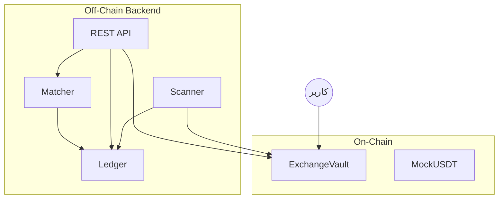

# eth-exchange-lab

یک پروژهٔ یادگیری و portfolio برای ساخت **backend صرافی رمزارز** با Go، Ethereum، و PostgreSQL — با تمرکز بر الگوهای production-minded و مستندات فارسی.

## این پروژه چیست؟

**eth-exchange-lab** شبیه‌سازی یک صرافی centralized کوچک است که:

- واریز **on-chain** (ETH / MockUSDT) را از قرارداد **ExchangeVault** می‌خواند
- موجودی کاربر را **off-chain** در **دفتر کل دوطرفه** (PostgreSQL) نگه می‌دارد
- سفارش‌ها را **off-chain match** می‌کند
- برداشت را با **workflow تأیید** و (اختیاری) امضای operator انجام می‌دهد



## چرا Go؟

| دلیل | توضیح |
|------|--------|
| Concurrency | goroutine برای scanner، outbox worker، HTTP |
| Deploy | single binary، مناسب service |
| Ecosystem | `go-ethereum` استاندارد صنعت |
| Learning | contrast با Java/Spring — wiring explicit، error explicit |

اگر از Java می‌آیید: domain/service/repository همان mental model است؛ فقط framework کمتر و `context.Context` به‌جای thread-local.

## چرا Ethereum؟

- مدل custody واقعی: کاربر به **قرارداد** واریز می‌کند نه مستقیم به DB
- event-driven integration (`DepositETH`, `DepositERC20`)
- تمرین **confirmations**، **reorg**، و **operator withdraw**
- Foundry برای test/deploy سریع local

**MockUSDT** فقط برای Anvil — جایگزین USDT mainnet نیست.

## Tech stack

| لایه | تکنولوژی |
|------|-----------|
| Backend | Go 1.22+ |
| API | net/http (stdlib) |
| DB | PostgreSQL 16 |
| Cache/Lock | Redis 7 |
| Events | Redpanda (Kafka API) |
| Chain local | Anvil (Foundry) |
| Contracts | Solidity 0.8 + OpenZeppelin |

## ساختار repo

```
cmd/api/                 — نقطه ورود
internal/domain/         — منطق خالص (ledger, matching, ...)
internal/application/    — use caseها + ports
internal/adapters/       — HTTP, Postgres, Redis, Kafka, Ethereum, scanner
contracts/               — MockUSDT, ExchangeVault
migrations/              — schema SQL
docs/                    — مستندات فارسی
scripts/                 — dev-up, deploy, demo
```

## راه‌اندازی سریع

```bash
# 1. زیرساخت
./scripts/dev-up.sh

# 2. قراردادها
./scripts/contracts-build.sh
./scripts/contracts-deploy-local.sh

# 3. تنظیم env
cp .env.example .env
# آدرس‌های deployments/local.json را در .env بگذارید

# 4. API
./scripts/backend-run.sh
```

Health:

```bash
curl http://localhost:8080/health/live
curl http://localhost:8080/health/ready
```

راهنمای کامل: [docs/local-run-fa.md](docs/local-run-fa.md)

## API نمونه

| Method | Path | توضیح |
|--------|------|--------|
| POST | `/api/v1/users` | ثبت کاربر |
| POST | `/api/v1/wallets` | ساخت wallet + آدرس |
| GET | `/api/v1/balances/{user_id}` | موجودی ledger |
| POST | `/api/v1/orders` | سفارش (Idempotency-Key) |
| POST | `/api/v1/withdrawals` | درخواست برداشت |
| POST | `/api/v1/admin/withdrawals/{id}/approve` | تأیید admin (local) |

## مستندات

| سند | موضوع |
|-----|--------|
| [architecture-fa.md](docs/architecture-fa.md) | معماری Clean/Hexagonal |
| [local-run-fa.md](docs/local-run-fa.md) | اجرای محلی |
| [smart-contracts-fa.md](docs/smart-contracts-fa.md) | Vault و MockUSDT |
| [exchange-scenario-fa.md](docs/exchange-scenario-fa.md) | جریان کامل صرافی |
| [ledger-fa.md](docs/ledger-fa.md) | حسابداری دوطرفه |
| [blockchain-scanner-fa.md](docs/blockchain-scanner-fa.md) | scanner و reorg |
| [withdrawal-flow-fa.md](docs/withdrawal-flow-fa.md) | state machine برداشت |
| [security-fa.md](docs/security-fa.md) | secrets و auth placeholder |
| [production-readiness-fa.md](docs/production-readiness-fa.md) | gapهای production |
| [private-key-management-fa.md](docs/private-key-management-fa.md) | hot/cold و Anvil |
| [plans-fa.md](docs/plans-fa.md) | بایگانی طرح‌ها |
| [cursor-rules-fa.md](docs/cursor-rules-fa.md) | قوانین Cursor |
| [interview-notes-fa.md](docs/interview-notes-fa.md) | نکات مصاحبه |

## پیش‌فرض‌های امنیتی

```env
ENABLE_SIGNING=false
ENABLE_MAINNET=false
```

- بدون approval صریح، mainnet tx نمی‌فرستیم
- private key واقعی در repo نیست
- `.env` در `.gitignore`

## چه چیز production-ready **نیست**

خلاصه — جزئیات در [production-readiness-fa.md](docs/production-readiness-fa.md):

- Authentication / JWT
- Matcher پایدار (in-memory)
- HSM / MPC / multisig
- Reorg reversal کامل برای deposit credited
- Rate limiting کامل
- Audit formal قراردادها

این **عمدی** است: lab برای یادگیری با safety gate.

## Makefile

```bash
make help
make test
make dev-up
make contracts-test
make run
```

## طرح‌های معماری

فهرس: [docs/plans/README.md](docs/plans/README.md) — طرح ۰۰۰۰۱ Phase 0.

## مجوز و هدف

پروژهٔ آموزشی/portfolio — نه توصیه مالی. استفاده از mainnet با دارایی واقعی بدون بازطراحی **توصیه نمی‌شود**.

## AGENTS

دستورالعمل agentها: [AGENTS.md](AGENTS.md)
