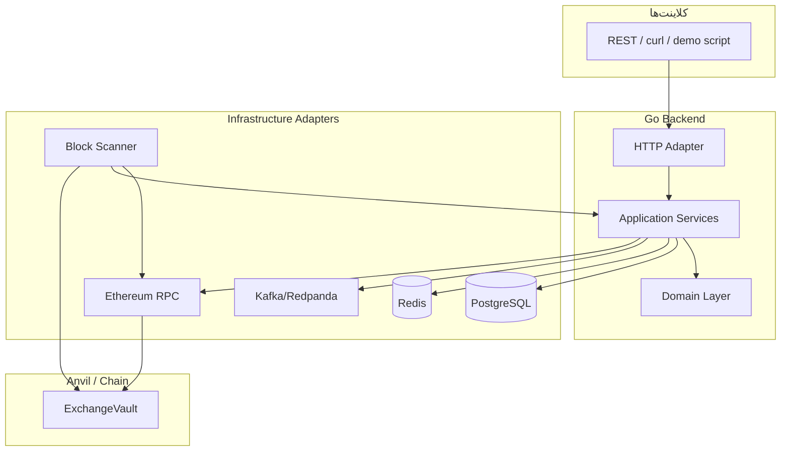
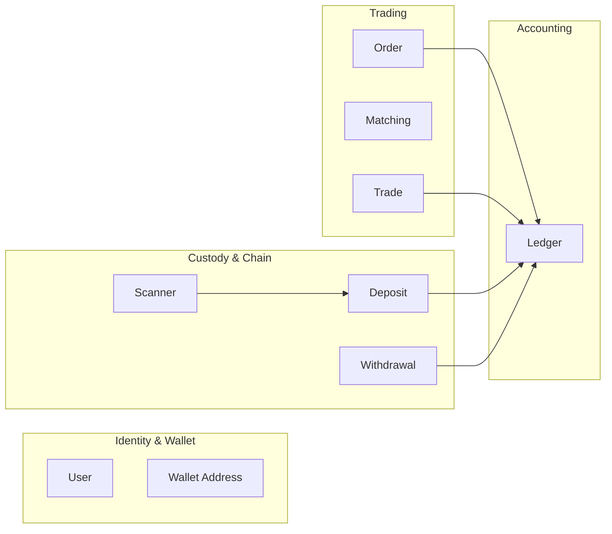

# معماری سیستم

این سند معماری **eth-exchange-lab** را برای توسعه‌دهندهٔ Java که Go و Ethereum را یاد می‌گیرد توضیح می‌دهد.

## هدف پروژه

شبیه‌سازی backend یک صرافی کوچک که:

- واریز on-chain (ETH/ERC20 به Vault) را می‌بیند
- موجودی کاربر را **off-chain** در PostgreSQL با **دفتر کل دوطرفه** نگه می‌دارد
- سفارش‌ها را off-chain match می‌کند
- برداشت را با workflow تأیید و (در local) امضای operator انجام می‌دهد

## چرا Clean / Hexagonal؟

در Java ممکن است با Spring Layers یا Hexagonal (Ports & Adapters) آشنا باشید. همان ایده اینجا اعمال شده:

| لایه Java معمول | معادل Go در این پروژه |
|------------------|------------------------|
| Domain entities | `internal/domain/*` |
| Use cases / Application services | `internal/application/*` |
| Ports (interfaces) | `internal/application/ports/ports.go` |
| Adapters (DB, REST, Kafka) | `internal/adapters/*` |
| Main / Bootstrap | `cmd/api/main.go` |

**چرا؟** منطق مالی (ledger، matching) نباید به PostgreSQL یا HTTP وابسته باشد. تست unit بدون DB ممکن می‌شود. تعویض Anvil با testnet فقط adapter Ethereum را عوض می‌کند.

## دیاگرام کلی



## لایه‌ها به تفصیل

### ۱. Domain (`internal/domain`)

**خالص** — import از database یا HTTP ندارد.

| پکیج | مسئولیت |
|------|---------|
| `ledger` | حساب، journal، اعتبارسنجی تراز debit/credit |
| `order`, `trade` | مدل سفارش و معامله |
| `matching` | موتور match در حافظه |
| `deposit`, `withdrawal` | state machine وضعیت‌ها |
| `wallet`, `user`, `asset`, `market` | موجودیت‌های پایه |

مثل entity + domain service در DDD؛ بدون annotation و framework.

### ۲. Application (`internal/application`)

Use caseها و **ports** (interfaces):

- `deposit/service.go` — ثبت واریز، تأییدیه، credit
- `ledger/service.go` — lock سفارش، settle معامله، برداشت
- `order/service.go` — ثبت سفارش + فراخوانی matcher
- `withdrawal/service.go` — درخواست، approve، broadcast

`ports/ports.go` قرارداد repositoryها را تعریف می‌کند — شبیه interface repository در Spring Data، اما پیاده‌سازی در adapter است.

### ۳. Adapters (`internal/adapters`)

| Adapter | نقش |
|---------|-----|
| `http` | REST API، health |
| `postgres` | repositoryها، UoW، migration schema |
| `redis` | client (آماده برای lock/cache) |
| `kafka` | outbox worker |
| `ethereum` | RPC client، tx sender |
| `scanner` | poll بلاک، event Vault |

### ۴. Platform (`internal/platform`)

cross-cutting: logger، metrics، retry، graceful shutdown.

## Bounded Contexts



مرزها در PostgreSQL با جداول جدا مشخص‌اند؛ integration از طریق application services و `UnitOfWork` انجام می‌شود.

## الگوهای کلیدی

### Unit of Work

عملیات مالی در transaction PostgreSQL (`postgres/uow.go`). شبیه `@Transactional` در Spring — اما explicit در Go.

### Idempotency

کلید یکتا برای journal، order، withdrawal (`idempotency_key`). retry امن بدون double-spend off-chain.

### Outbox

رویدادها ابتدا در `outbox_events` ذخیره می‌شوند؛ worker به Kafka publish می‌کند — الگوی transactional outbox.

### Context

همهٔ عملیات I/O `context.Context` می‌گیرند (cancel، timeout) — معادل request scope در servlet، اما explicit.

## تفاوت‌های Go برای Java developer

| موضوع | Java | Go در این پروژه |
|-------|------|-----------------|
| DI | Spring container | wiring دستی در `main.go` |
| Error | exception | `error` return + wrap |
| Null | Optional | pointer یا zero value |
| Decimal money | BigDecimal | `shopspring/decimal` |
| Concurrency | threads | goroutine + context cancel |

## اجرای محلی

معماری را در کد ببینید:

```bash
./scripts/dev-up.sh
go build -o bin/api ./cmd/api
```

## ریسک production

- Matcher **in-memory** است — restart = از دست رفتن orderbook (برای prod باید persistent شود).
- Auth واقعی پیاده نشده — فقط placeholder.
- Rate limit در HTTP کامل نیست.
- Reorg reversal journal (`REORG_REVERSAL`) در domain تعریف شده؛ پیاده‌سازی کامل reversal واریز credited نیاز به hardening دارد.

جزئیات در [production-readiness-fa.md](./production-readiness-fa.md).
