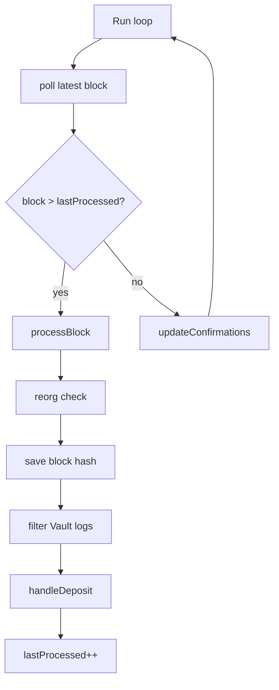
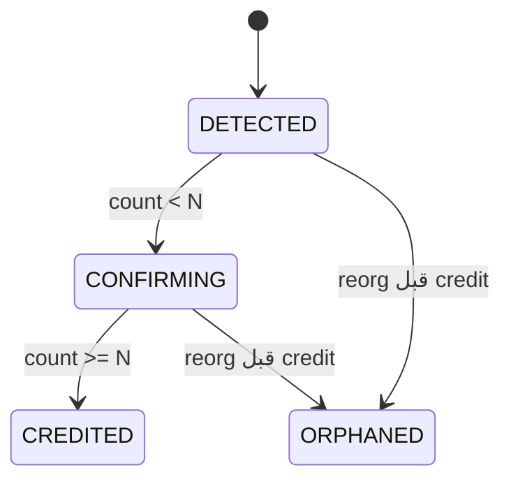

# اسکنر بلاک‌چین

اسکنر (`internal/adapters/scanner`) بلاک‌های Anvil/Ethereum را poll می‌کند، eventهای **ExchangeVault** را پردازش می‌کند، confirmation می‌شمارد و واریز را به ledger وصل می‌کند.

## چرا اسکنر جدا از «فقط listen WebSocket»؟

| رویکرد | مزیت | معایب |
|--------|------|-------|
| Poll (این پروژه) | ساده، replay بلاک، state در DB | latency بیشتر |
| WebSocket subscribe | real-time | reconnect، gap handling سخت‌تر |

برای learning و portfolio، poll با interval قابل تنظیم (`SCANNER_POLL_INTERVAL`، پیش‌فرض ۲s) کافی است. production often ترکیب هر دو + checkpoint پایدار.

## جریان کلی



## State در database

| جدول | نقش |
|------|-----|
| `scanner_state` | آخرین بلاک پردازش‌شده per chain_id |
| `blockchain_blocks` | hash بلاک برای detect reorg |
| `blockchain_events` | dedup event: `(chain_id, tx_hash, log_index)` |
| `deposits` | lifecycle واریز کاربر |

## پردازش event واریز

1. `ClassifyEvent(log)` — `DepositETH` یا `DepositERC20`
2. parse user address و amount
3. `wallets.FindAddress(chain_id, userAddr)` — اگر ناشناس، نادیده
4. `depositSvc.RecordDetected(...)` — status `DETECTED`
5. dedup با unique constraint

### تبدیل amount

- ETH: wei → decimal با shift **-18**
- USDT: raw → shift **-6**

## Confirmations

پس از هر poll، `updateConfirmations`:

```
confirmations = latestBlock - depositBlockNumber + 1
```

اگر `confirmations >= required_confirmations` (env: `CONFIRMATION_COUNT`، پیش‌فرض **3**):

- `ledger.CreditDeposit` — journal `DEPOSIT_CREDIT`
- status → `CREDITED`



**چرا N confirmation؟** کاهش ریسک reorg بعد از credit — در mainnet N بسته به asset و risk policy (BTC often 6+، ETH کمتر).

## Reorg handling

هنگام `processBlock`:

1. بلاک قبلاً ذخیره شده؟ hash جدید با hash ذخیره‌شده مقایسه
2. اگر متفاوت → **reorg detected**
3. `OrphanEventsFromBlock` — eventهای بلاک orphan
4. outbox: `exchange.blockchain.reorg`

### محدودیت فعلی (مهم)

- deposit **قبل از CREDITED** می‌تواند `ORPHANED` شود
- deposit **بعد از CREDITED** نیاز `REORG_REVERSAL` journal دارد — در domain تعریف شده؛ reversal کامل باید hardening شود
- scanner از block 0 یا `SCANNER_START_BLOCK` شروع می‌کند

در Anvil reorg نادر است؛ روی mainnet/testnet حیاتی است.

## Dedup

Unique keys:

- `deposits`: `(chain_id, tx_hash, log_index)`
- `blockchain_events`: همان

جلوگیری از double credit اگر scanner دوباره همان log را ببیند.

## پیکربندی

| متغیر | پیش‌فرض | معنی |
|-------|---------|------|
| `ETH_RPC_URL` | localhost:8545 | RPC |
| `CHAIN_ID` | 31337 | Anvil |
| `VAULT_CONTRACT_ADDRESS` | — | **الزامی** برای scan |
| `CONFIRMATION_COUNT` | 3 | حداقل confirmation |
| `SCANNER_START_BLOCK` | 0 | شروع scan |
| `SCANNER_POLL_INTERVAL` | 2s | فاصله poll |

## Startup

در `cmd/api/main.go` scanner به عنوان goroutine با `context` cancel در shutdown اجرا می‌شود.

اگر `VAULT_CONTRACT_ADDRESS` خالی باشد، scan event skip می‌شود (بلاک‌ها هنوز save می‌شوند).

## مقایسه با Java

- loop بی‌پایان ≈ `@Scheduled` یا consumer thread — در Go `select` روی `ctx.Done()` و ticker
- RPC errors → log + retry در poll بعدی (production: backoff + circuit breaker در ethereum adapter)

## اجرای محلی — تست دستی

1. backend + scanner running
2. wallet address از API
3. واریز به Vault با cast
4. مشاهده log scanner و `GET /api/v1/deposits/{user_id}`

```bash
# مثال: block فعلی
cast block-number --rpc-url http://localhost:8545
```

## ریسک production

| ریسک | mitigation |
|------|------------|
| RPC outage | retry، multi-RPC، alert |
| lag scanner | metric `blocks_behind` |
| missed block | gap detection، rescan |
| reorg عمیق | freeze withdraw، manual reconcile |
| wrong chain_id | verify at startup |

## مستندات مرتبط

- [smart-contracts-fa.md](./smart-contracts-fa.md) — events Vault
- [ledger-fa.md](./ledger-fa.md) — DEPOSIT_CREDIT
- [exchange-scenario-fa.md](./exchange-scenario-fa.md)
