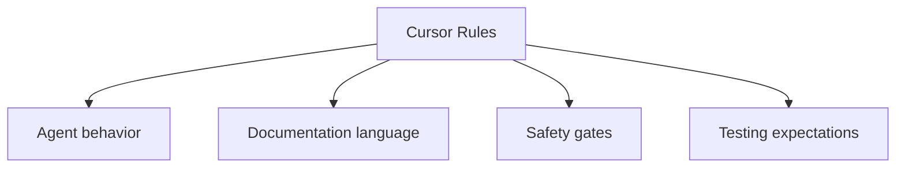

# قوانین Cursor (Cursor Rules)

پوشه `.cursor/rules/` دستورالعمل‌های دائمی برای AI agent و توسعه‌دهنده در Cursor است. این سند هر rule را به فارسی خلاصه می‌کند.

## چرا rules؟

بدون context ثابت، agent ممکن است:

- mainnet tx بفرستد
- secret log کند
- معماری را نقض کند
- doc انگلیسی بنویسد

Rules مثل **team coding standards** در `.editorconfig` + architecture guidelines — اما برای LLM.

## نمای کلی



## فهرست ruleها

| فایل | alwaysApply | موضوع |
|------|-------------|--------|
| `00-project-overview.mdc` | ✅ | معرفی eth-exchange-lab |
| `01-go-backend.mdc` | ✅ (Go files) | idiomatic Go، Clean Architecture |
| `02-ethereum-smart-contracts.mdc` | ✅ (contracts) | Solidity، Foundry، reorg |
| `03-security-financial-systems.mdc` | ✅ | idempotency، ledger، audit |
| `04-persian-documentation.mdc` | ✅ (*.md) | مستندات فارسی |
| `05-testing-and-quality.mdc` | ✅ | test، make، gofmt |
| `06-no-dangerous-actions.mdc` | ✅ | ممنوعیت mainnet، sudo، ... |
| `07-plan-archiving.mdc` | plan mode | `docs/plans/NNNNN` |
| `AGENTS.mdc` | ✅ | خلاصه برای agent |

همچنین [AGENTS.md](../AGENTS.md) در root — mirror دستورالعمل‌ها.

## 00 — Project Overview

- نام: eth-exchange-lab
- Go + Solidity + Persian docs
- domains: wallet، deposit، withdraw، ledger، order، trade، scanner
- plans در `docs/plans/`

## 01 — Go Backend

برای `**/*.go`:

- `context.Context` برای I/O
- error return نه panic (جز startup)
- domain مستقل از infra
- interfaces کوچک near consumer
- graceful shutdown، structured log
- **هرگز** log secret

برای Java dev: شبیه Spring layered → hexagonal با wiring دستی.

## 02 — Ethereum & Smart Contracts

- Solidity 0.8.x، Foundry، OpenZeppelin
- ReentrancyGuard، Pausable، CEI
- dedup: `chain_id + tx_hash + log_index`
- confirmations configurable
- mainnet فقط با approval صریح user

## 03 — Security Financial Systems

- هر balance change idempotent
- DB transaction + double-entry
- row lock برای withdraw/order
- audit log
- rate limit placeholder
- mainnet signing off by default

## 04 — Persian Documentation

- **همه doc کاربر-محور فارسی**
- چرا component وجود دارد
- local run + production risk
- Mermaid برای flowها
- مثال deposit → trade → withdraw

## 05 — Testing & Quality

- unit: domain، matching، ledger
- Foundry tests
- `go test ./...` — output را بخوان
- make targets
- deterministic tests

## 06 — No Dangerous Actions

بدون approval صریح user:

- mainnet tx / deploy
- real private key
- print secrets
- drop DB
- sudo
- push git
- disable security

Local: Docker Compose ترجیح.

## 07 — Plan Archiving

وقتی plan نهایی شد:

- `docs/plans/NNNNN-slug.md`
- frontmatter استاندارد
- update `docs/plans/README.md`
- never renumber

توضیح کامل: [plans-fa.md](./plans-fa.md)

## AGENTS.mdc

خلاصه یک‌صفحه‌ای برای agent — همان AGENTS.md.

## نحوهٔ استفاده برای شما

1. rule جدید → `.cursor/rules/XX-name.mdc` با frontmatter `description`, `globs`, `alwaysApply`
2. بعد از تغییر rule، در chat به agent بگویید context refresh شود
3. conflict بین rule و user message → **user message برنده**

## skill vs rule

- **Rules**: همیشه در context (alwaysApply)
- **Skills**: agent وقتی موضوع match کند می‌خواند (مثلاً create PR)

## اجرای محلی

Rules روی runtime اثر ندارند — فقط رفتار توسعه. برای run:

```bash
./scripts/dev-up.sh
```

## ریسک

agent با rule 06 هنوز ممکن است command خطرناک **پیشنهاد** دهد — شما approve terminal را رد کنید.

## مستندات مرتبط

- [plans-fa.md](./plans-fa.md)
- [security-fa.md](./security-fa.md)
