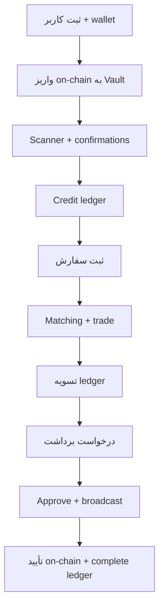
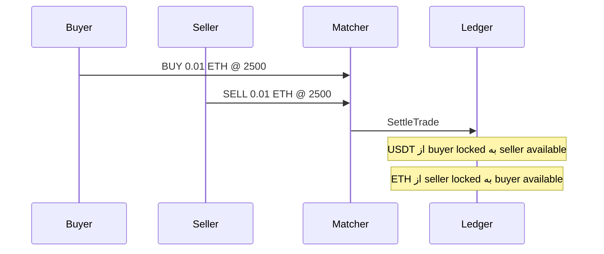

# سناریوی کامل صرافی

جریان end-to-end از ثبت‌نام تا برداشت — برای درک **چرا** هر قطعه وجود دارد.

## نقشهٔ سفر کاربر



## ۱. ثبت کاربر و wallet

**چرا؟** scanner باید بداند آدرس on-chain متعلق به کدام `user_id` است.

```http
POST /api/v1/users
{"email": "trader@example.com"}

POST /api/v1/wallets
{"user_id": "<uuid>", "label": "main"}
```

پاسخ شامل `address` و `chain_id` (31337 در local) است.

## ۲. واریز (Deposit)

### on-chain

کاربر ETH یا USDT را به **ExchangeVault** می‌فرستد:

- ETH: `receive()` یا `depositETH(depositRef)`
- USDT: `approve(Vault)` سپس `depositERC20(USDT, amount, ref)`

### off-chain — وضعیت‌ها

| Status | معنی |
|--------|------|
| `DETECTED` | event دیده شد |
| `CONFIRMING` | منتظر N confirmation |
| `CREDITED` | journal زده شد |
| `ORPHANED` | reorg — بلاک orphan شد |

### ledger

Journal نوع `DEPOSIT_CREDIT`:

- Debit: `exchange:EXCHANGE_HOT:USDT`
- Credit: `user:<id>:USER_AVAILABLE:USDT`

**چرا EXCHANGE_HOT؟** نمایانگر دارایی on-chain در custody صرافی در حسابداری off-chain.

## ۳. مشاهده موجودی

```http
GET /api/v1/balances/{user_id}
GET /api/v1/ledger/{user_id}
```

موجودی از **مجموع ledger entries** محاسبه می‌شود، نه از balance مستقیم wallet on-chain.

## ۴. ثبت سفارش (Order)

```http
POST /api/v1/orders
Idempotency-Key: order-unique-1
{
  "user_id": "...",
  "market": "ETH-USDT",
  "side": "BUY",
  "price": "2500",
  "quantity": "0.01"
}
```

### قبل از match — lock

| Side | قفل می‌شود |
|------|------------|
| BUY | USDT = price × qty |
| SELL | ETH = qty |

Journal: `ORDER_LOCK` — از `USER_AVAILABLE` به `USER_LOCKED`.

**چرا lock؟** جلوگیری از double-spend off-chain هنگام چند سفارش همزمان — شبیه reserved balance در صرافی‌های centralized.

## ۵. Matching و Trade

موتور in-memory در `internal/domain/matching` — limit order، partial fill.

وقتی match رخ دهد:

1. رکورد `trades` در DB
2. Journal `TRADE` — جابجایی ETH/USDT بین buyer/seller + fee به `EXCHANGE_FEE`



## ۶. Orderbook و trades

```http
GET /api/v1/orderbook?market=ETH-USDT
GET /api/v1/trades?market=ETH-USDT
```

Orderbook از matcher in-memory — بعد از restart خالی می‌شود (محدودیت local).

## ۷. لغو سفارش

```http
DELETE /api/v1/orders/{id}
```

Journal `ORDER_CANCEL` — unlock balance.

## ۸. برداشت (Withdrawal)

```http
POST /api/v1/withdrawals
Idempotency-Key: wd-1
{
  "user_id": "...",
  "asset": "USDT",
  "amount": "100",
  "destination": "0x..."
}
```

1. `WITHDRAWAL_LOCK` — available → withdrawal_locked
2. Status: `PENDING_APPROVAL`
3. Admin: `POST /api/v1/admin/withdrawals/{id}/approve`
4. اگر `ENABLE_SIGNING=true`: broadcast به Vault
5. بعد از تأیید chain: `WITHDRAWAL_COMPLETE`

جزئیات: [withdrawal-flow-fa.md](./withdrawal-flow-fa.md)

## ۹. رویدادهای domain (Kafka)

via outbox:

- `exchange.deposit.detected`
- `exchange.deposit.credited`
- `exchange.withdrawal.requested`
- `exchange.blockchain.reorg`

برای analytics، notification، یا سرویس‌های downstream — در local Redpanda کافی است.

## مثال عددی (USDT)

1. واریز 10,000 USDT → available = 10000
2. BUY 0.01 ETH @ 2500 → lock 25 USDT
3. Match → available ETH += 0.01، USDT locked -= 25
4. Withdraw 500 USDT → lock 500، بعد از chain complete available -= 500

## اجرای محلی

```bash
./scripts/dev-up.sh
./scripts/contracts-build.sh && ./scripts/contracts-deploy-local.sh
# .env را پر کنید
./scripts/backend-run.sh
./scripts/demo-full-flow.sh
```

برای flow کامل، واریز on-chain + صبر برای ۳ confirmation لازم است.

## ریسک production

| موضوع | خطر |
|-------|------|
| Matcher in-memory | از دست رفتن سفارش باز |
| بدون auth | هر کسی API را صدا می‌زند |
| reorg روی deposit credited | نیاز reversal journal |
| race در withdraw | نیاز row lock و idempotency سخت‌تر |

## مستندات مرتبط

- [ledger-fa.md](./ledger-fa.md)
- [blockchain-scanner-fa.md](./blockchain-scanner-fa.md)
- [withdrawal-flow-fa.md](./withdrawal-flow-fa.md)
