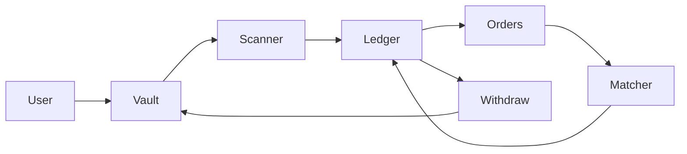

# نکات مصاحبه (Interview Notes)

Talking points برای ارائهٔ **eth-exchange-lab** در مصاحبه — backend، blockchain، یا fintech. برای کسی با پس‌زمینه Java که Go/Ethereum یاد گرفته.

## Elevator pitch (۳۰ ثانیه)

«یک mini crypto exchange backend ساختم: واریز on-chain به Vault Solidity، scanner event، credit در PostgreSQL با double-entry ledger، matching off-chain، و withdrawal با workflow approve. Go با Hexagonal Architecture، mainnet به‌صورت پیش‌فرض غیرفعال.»

## چرا این پروژه؟

- نشان می‌دهد **financial correctness** (ledger، idempotency) را جدی می‌گیرید
- bridge بین **traditional backend** و **Web3 custody**
- production-minded بدون ادعای production-ready

## معماری — سوالات رایج

### «چرا Clean/Hexagonal؟»

Domain (matching، ledger validation) بدون DB test می‌شود. adapter Ethereum/QPostgres قابل تعویض. مثل ports & adapters در microservice Java.

### «Bounded contextها؟»

Identity/Wallet، Custody/Chain، Accounting، Trading — integration via application services و UoW.

### «Outbox pattern چرا؟»

Publish Kafka همراه commit DB — avoid dual-write bug. insert `outbox_events` در همان transaction.

## Ledger — سوالات رایج

### «چرا double-entry نه balance column؟»

Audit trail، reconciliation، catch bug (هر journal balanced). `ValidateJournal`: sum debit = sum credit.

### «Account types؟»

AVAILABLE / LOCKED / WITHDRAWAL_LOCKED برای user؛ EXCHANGE_HOT / EXCHANGE_FEE برای صرافی.

### «Idempotency؟»

`idempotency_key` unique روی journals، orders، withdrawals — safe HTTP retry.

## Blockchain — سوالات رایج

### «چطور deposit detect می‌کنید؟»

Poll blocks → filter Vault logs → dedup `(chain_id, tx_hash, log_index)` → map address to user → wait N confirmations → `DEPOSIT_CREDIT`.

### «Reorg؟»

Compare stored block hash؛ orphan events؛ deposit قبل credit → ORPHANED. بعد credit → نیاز reversal journal (hardening).

### «چرا confirmation count؟»

کاهش probability credit قبل از finality chain.

## Matching — سوالات رایج

### «In-memory matcher trade-off؟»

Simple، fast for lab؛ restart loses book — prod needs Redis/Postgres orderbook.

### «Partial fill؟»

Engine domain support — limit orders، fee on quote.

## Withdrawal — سوالات رایج

### «State machine؟»

PENDING_APPROVAL → APPROVED → SIGNING → BROADCASTED → CONFIRMED؛ lock ledger before chain.

### «چرا signing disabled default؟»

Safety — no accidental mainnet/local tx.

### «Hot wallet risk؟»

Acknowledge — prod: HSM, limits, multisig.

## Go vs Java — اگر پرسیدند

| موضوع | پاسخ کوتاه |
|-------|------------|
| Why Go? | concurrency، single binary، good for infra services |
| DI | explicit wiring in main — simpler than Spring magic |
| Errors | explicit `if err != nil` — no hidden stack |
| Types | composition over inheritance |

## Security — honesty points

**بگویید چه ندارید:**

- Real auth/JWT
- Full rate limit
- HSM
- Complete reorg reversal
- Formal audit

**بگویید چه دارید:**

- Config gates (`ENABLE_MAINNET`, `ENABLE_SIGNING`)
- Audit log table
- Contract OZ patterns
- Cursor rules against dangerous ops

## System design drill

«1000 withdraw/sec؟»

- Queue per hot wallet، nonce manager
- Separate read API
- Batch on-chain (L2 / internal netting) — out of scope lab

«RPC down؟»

- Circuit breaker، multi-provider، scanner lag alert

## دیاگرام برای whiteboard



## Metrics / observability

- structured logs (zerolog)
- metrics scaffold
- health ready: postgres, redis, rpc

Prod: Prometheus، Grafana، SLO on scanner lag.

## تست‌ها

- `ledger_test`, `engine_test` — domain
- Foundry — reentrancy، deposit/withdraw
- `go test ./...`

## سوالات از interviewer

- custody model آن‌ها on-chain vs off-chain؟
- matching in-house یا external LP؟
- reorg policy per asset؟

## لینک به repo structure

```
cmd/api          — entry
internal/domain  — pure logic
internal/application — use cases
internal/adapters — infra
contracts/       — Vault, MockUSDT
docs/            — Persian docs
```

## جملات closing

«این پروژه را به‌عنوان learning lab با safety default ساختم؛ می‌دانم gapهای production کجاست و phase بعدی auth و persistent matcher است.»

## مستندات عمیق‌تر

- [architecture-fa.md](./architecture-fa.md)
- [exchange-scenario-fa.md](./exchange-scenario-fa.md)
- [production-readiness-fa.md](./production-readiness-fa.md)
