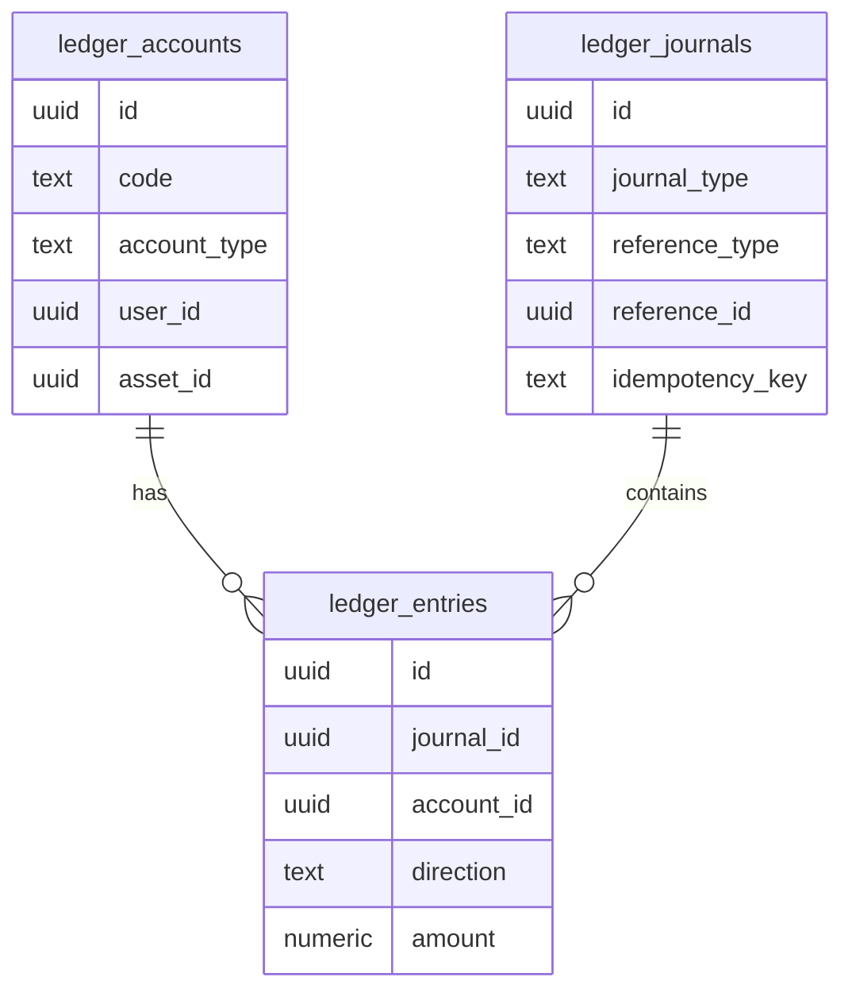

# دفتر کل دوطرفه (Double-Entry Ledger)

موجودی کاربر در این پروژه **حقیقت مالی off-chain** است و فقط از طریق journalهای متعادل تغییر می‌کند.

## چرا double-entry؟

در سیستم مالی centralized (بانک، صرافی):

- هر انتقال باید **تراز** باشد: مجموع debit = مجموع credit
- audit trail غیرقابل حذف (append-only journals)
- reconciliation با on-chain از طریق حساب‌های exchange

برای Java developer: شبیه general ledger در ERP — هر عملیات business یک سند حسابداری با چند سطر.

## مدل داده



## انواع حساب (`AccountType`)

تعریف در `internal/domain/ledger/ledger.go`:

| نوع | کد نمونه | معنی |
|-----|----------|------|
| `USER_AVAILABLE` | `user:<uuid>:USER_AVAILABLE:USDT` | قابل معامله / برداشت |
| `USER_LOCKED` | `user:<uuid>:USER_LOCKED:ETH` | قفل برای سفارش باز |
| `USER_WITHDRAWAL_LOCKED` | `user:<uuid>:USER_WITHDRAWAL_LOCKED:USDT` | قفل برای برداشت در جریان |
| `EXCHANGE_HOT` | `exchange:EXCHANGE_HOT:ETH` | custody on-chain (حساب صرافی) |
| `EXCHANGE_FEE` | `exchange:EXCHANGE_FEE:USDT` | کارمزد معاملات |

تابع `AccountCode(userID, accountType, symbol)` کد استاندارد می‌سازد.

## انواع journal (`JournalType`)

| JournalType | trigger | اثر کلی |
|-------------|---------|---------|
| `DEPOSIT_CREDIT` | واریز confirmed | Hot ↓ debit، user available ↑ credit |
| `ORDER_LOCK` | ثبت سفارش | available ↓ debit، locked ↑ credit |
| `TRADE` | match | جابجایی بین buyer/seller + fee |
| `ORDER_CANCEL` | لغو | locked → available |
| `WITHDRAWAL_LOCK` | درخواست برداشت | available → withdrawal_locked |
| `WITHDRAWAL_COMPLETE` | برداشت on-chain OK | withdrawal_locked → hot |
| `REORG_REVERSAL` | reorg (planned) | برگشت credit واریز |

## قانون طلایی

> **هرگز balance را مستقیم UPDATE نکنید.** فقط `PostJournal` با lines متعادل.

اعتبارسنجی در domain:

```go
ValidateJournal(lines) // debits == credits
```

## مثال: واریز ۱۰۰ USDT

| Account | Direction | Amount |
|---------|-----------|--------|
| exchange:EXCHANGE_HOT:USDT | DEBIT | 100 |
| user:xxx:USER_AVAILABLE:USDT | CREDIT | 100 |

**تفسیر:** صرافی می‌گوید ۱۰۰ USDT on-chain در hot دارد و ۱۰۰ به کاربر بدهکار است (credit = افزایش بدهی به کاربر = افزایش موجودی کاربر).

## مثال: BUY order lock

قفل ۲۵ USDT برای خرید ۰.۰۱ ETH @ ۲۵۰۰:

| Account | Direction | Amount |
|---------|-----------|--------|
| user:xxx:USER_AVAILABLE:USDT | DEBIT | 25 |
| user:xxx:USER_LOCKED:USDT | CREDIT | 25 |

## مثال: Trade settlement

Buyer B، Seller S — ۰.۰۱ ETH @ ۲۵۰۰ USDT، fee ۰.۱٪:

- USDT locked buyer → seller available (منهای fee)
- ETH locked seller → buyer available
- fee → EXCHANGE_FEE

پیاده‌سازی: `ledger/service.go` → `SettleTrade`.

## Idempotency

هر journal `idempotency_key` یکتا دارد، مثلاً:

- `deposit-credit:<deposit_uuid>`
- `order-lock:<client-key>`

retry HTTP امن — duplicate journal insert fail می‌شود.

## Unit of Work

`PostBalancedJournal` و عملیات compound در `uow.WithinTx` — atomicity مثل `@Transactional`.

## API

```http
GET /api/v1/balances/{user_id}
GET /api/v1/ledger/{user_id}?limit=50&offset=0
```

Balance = aggregate entries per account code.

## مقایسه با Java

| مفهوم Java | این پروژه |
|------------|-----------|
| BigDecimal | shopspring/decimal |
| @Transactional | postgres UoW |
| Entity Account | ledger_accounts table |
| Posting service | application/ledger/service.go |

## Reconciliation با chain

مجموع `EXCHANGE_HOT` باید با balance Vault on-chain **نزدیک** باشد (منهای pending withdraw و timing). در production job روزانه reconciliation اجباری است.

## اجرای محلی

بعد از migration و credit deposit:

```bash
curl http://localhost:8080/api/v1/balances/<user_id>
curl http://localhost:8080/api/v1/ledger/<user_id>
```

تست unit: `internal/domain/ledger/ledger_test.go`

## ریسک production

| ریسک | mitigation |
|------|------------|
| journal ناقص | فقط PostJournal با ValidateJournal |
| race condition | row lock + UoW |
| reorg بعد credit | REORG_REVERSAL + freeze withdraw |
| precision | NUMERIC(38,18) در Postgres |

## مستندات مرتبط

- [exchange-scenario-fa.md](./exchange-scenario-fa.md)
- [blockchain-scanner-fa.md](./blockchain-scanner-fa.md) — trigger DEPOSIT_CREDIT
