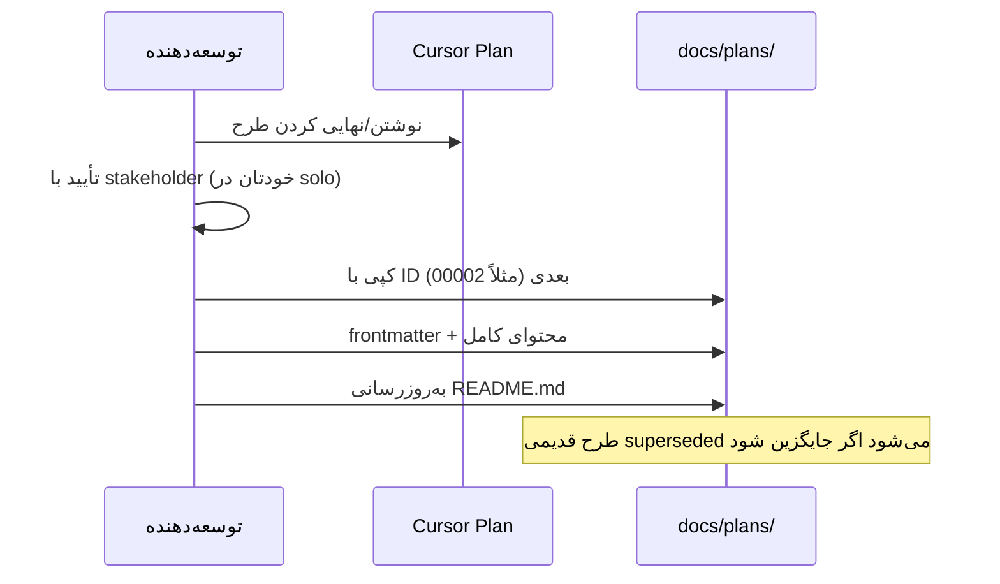

# workflow بایگانی طرح‌ها

این سند توضیح می‌دهد **چرا** و **چگونه** طرح‌های پروژه در `docs/plans/` بایگانی می‌شوند.

## چرا بایگانی؟

در توسعهٔ این پروژه از Cursor Plan mode استفاده می‌شود. فایل‌های plan داخل Cursor **موقت** هستند و ممکن است در به‌روزرسانی IDE یا تغییر session از بین بروند.

بایگانی در repo این مزایا را دارد:

1. **تاریخچهٔ تصمیم** — چرا Vault on-chain و ledger off-chain؟ چرا MockUSDT با ۶ رقم اعشار؟
2. **هماهنگی تیم/آینده** — هر کسی clone کند، منبع حقیقت را می‌بیند.
3. **ردیابی فازها** — فاز ۰ (معماری) جدا از فاز ۱ (اسکلت) و بعدی‌ها.

برای توسعه‌دهندهٔ Java: شبیه ADR (Architecture Decision Record) است، اما با شماره‌گذاری sequential و frontmatter استاندارد.

## قوانین (خلاصهٔ rule 07)

| قانون | توضیح |
|-------|--------|
| مسیر | `docs/plans/NNNNN-<slug>.md` |
| شناسه | پنج رقم: `00001`, `00002`, ... |
| frontmatter | `plan_id`, `title`, `status`, `created`, `phase`, `supersedes`, `superseded_by` |
| index | بعد از هر طرح جدید، `docs/plans/README.md` به‌روز شود |
| حذف | بدون تأیید صریح کاربر ممنوع |
| Cursor داخلی | ephemeral؛ `docs/plans/` منبع رسمی است |

## گام‌به‌گام



### ۱. پیدا کردن ID بعدی

بالاترین شمارهٔ موجود در `docs/plans/` را ببینید. الان: **00001** → بعدی **00002**.

### ۲. نام فایل

فرمت: `00002-withdrawal-hardening.md` — slug کوتاه و kebab-case.

### ۳. frontmatter نمونه

```yaml
---
plan_id: 00002
title: سخت‌سازی برداشت
status: approved
created: 2026-06-15
supersedes: null
superseded_by: null
phase: 7
---
```

اگر طرح جدید طرح ۰۰۰۰۱ را جایگزین کند:

- در ۰۰۰۰۲: `supersedes: 00001`
- در ۰۰۰۰۱: `superseded_by: 00002` و `status: superseded`

### ۴. محتوا

طرح باید شامل باشد:

- خلاصه و اهداف
- تصمیم‌های معماری (جدول یا لیست)
- دیاگرام Mermaid در صورت نیاز
- فازها و todoها
- ریسک‌های production

### ۵. به‌روزرسانی index

یک ردیف به جدول `docs/plans/README.md` اضافه کنید.

## رابطه با AGENTS.md

فایل [AGENTS.md](../AGENTS.md) به agentها می‌گوید طرح‌ها را در `docs/plans/` بایگانی کنند. rule `07-plan-archiving.mdc` جزئیات را enforce می‌کند.

## چه چیز را بایگانی **نکنیم**

- یادداشت‌های روزانه یا debug log
- draftهای نیمه‌کاره
- اسکرین‌شات یا خروجی terminal

فقط طرح‌های **تأییدشده** و **قابل اجرا** بایگانی شوند.

## اجرای محلی

بایگانی فقط فایل Markdown است؛ نیازی به Docker یا migrate ندارد. commit را خودتان انجام دهید وقتی آماده بودید.

## ریسک production

بایگانی جای **اجرا** نیست. تأیید طرح در repo به معنی آماده بودن برای mainnet **نیست**. همیشه `ENABLE_MAINNET=false` و `ENABLE_SIGNING=false` پیش‌فرض بمانند مگر workflow production جداگانه تأیید شود.
