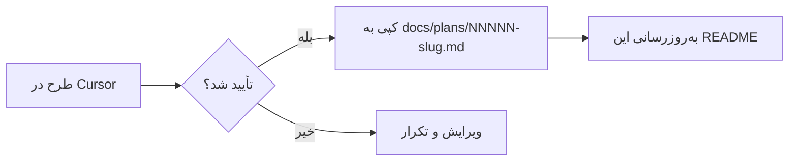

# فهرست طرح‌های بایگانی‌شده

این پوشه **آرشیو رسمی** طرح‌های تأییدشدهٔ پروژهٔ eth-exchange-lab است. هر طرح یک شناسهٔ پنج‌رقمی دارد و پس از نهایی شدن در Cursor، نسخهٔ پایدار آن اینجا نگه‌داری می‌شود.

## چرا این فهرست وجود دارد؟

- طرح‌های داخل Cursor موقت هستند؛ این پوشه تاریخچهٔ تصمیم‌های معماری را حفظ می‌کند.
- قبل از شروع فاز جدید، می‌توانید ببینید چه چیزی قبلاً تصمیم گرفته شده است.
- شناسه‌ها **هرگز دوباره استفاده نمی‌شوند** (قانون ۰۷).

## نحوهٔ خواندن

| ستون | معنی |
|------|------|
| شناسه | عدد پنج‌رقمی مثل `00001` |
| عنوان | موضوع اصلی طرح |
| فاز | فاز پیاده‌سازی (۰ = معماری، ۱+ = اجرا) |
| وضعیت | `approved`، `superseded`، ... |
| تاریخ | تاریخ ایجاد (UTC) |
| فایل | مسیر فایل Markdown |

## طرح‌ها

| شناسه | عنوان | فاز | وضعیت | تاریخ | فایل |
|-------|--------|-----|--------|-------|------|
| 00001 | Phase 0 Architecture Plan | 0 | approved | 2026-06-01 | [00001-phase-0-architecture.md](./00001-phase-0-architecture.md) |

## خلاصهٔ طرح ۰۰۰۰۱

طرح فاز ۰ معماری کلی **eth-exchange-lab** را تعریف می‌کند:

- بک‌اند Go با معماری Clean/Hexagonal
- قراردادهای Solidity (MockUSDT، ExchangeVault) با Foundry
- PostgreSQL برای دفتر کل دوطرفه، Redis برای قفل/کش، Redpanda برای رویدادها
- اسکنر بلاک‌چین، تأییدیه‌ها، و مدیریت reorg
- مچینگ off-chain و برداشت با workflow تأیید
- مستندات فارسی و غیرفعال بودن mainnet به‌صورت پیش‌فرض

برای جزئیات workflow بایگانی، [plans-fa.md](../plans-fa.md) را بخوانید.

