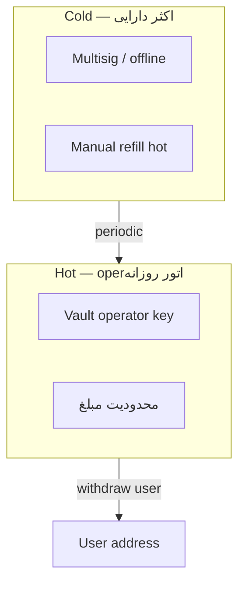
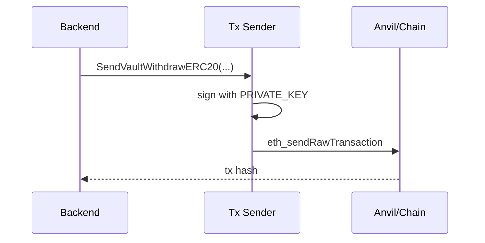

# مدیریت کلید خصوصی

کلید خصوصی در این پروژه **فقط** برای امضای تراکنش operator Vault در محیط local است — نه الگوی production.

## چرا اصلاً private key در backend؟

Vault برداشت (`withdrawETH` / `withdrawERC20`) فقط توسط **operator** (یا owner) انجام می‌شود. backend وقتی `ENABLE_SIGNING=true` باشد، نقش operator را بازی می‌کند و tx می‌سازد.

واریز on-chain توسط **کاربر** با wallet خودش انجام می‌شود — backend کلید کاربر را ندارد (مدل درست).

## Hot vs Cold



| نوع | این پروژه | Production |
|-----|-----------|------------|
| Hot | `PRIVATE_KEY` در `.env` | HSM/MPC، limit، monitor |
| Cold | ندارد | اکثر USDT/ETH |

## Anvil — کلیدهای پیش‌فرض

Anvil ۱۰ account test با کلیدهای شناخته‌شده می‌سازد. **Account #0** معمولاً deployer و operator است:

```
0xac0974bec39a17e36ba4a6b4d238ff944bacb478cbed5efcae784d7bf4f2ff80
```

**این کلید public knowledge است** — فقط روی chain local.

Foundry/Anvil docs: هرگز همین را روی mainnet استفاده نکنید.

## Config مرتبط

```env
ENABLE_SIGNING=false    # پیش‌فرض — tx نمی‌فرستد
ENABLE_MAINNET=false
PRIVATE_KEY=            # خالی تا signing فعال نشود
```

Gate در `internal/config/config.go`:

- signing بدون key → startup error
- mainnet بدون signing → error
- mainnet با `APP_ENV != production` → error

## Operator در قرارداد

`ExchangeVault` در deploy:

- `owner` = deployer
- `operator` = آدرس backend hot wallet

`setOperator` فقط owner — rotation بدون redeploy vault.

## جریان امضا



`internal/adapters/ethereum/tx_sender.go` — timeout و retry around RPC.

## Nonce

هر آدرس operator nonce sequential دارد. concurrent broadcast بدون queue → stuck tx.

Production: **single writer** per hot address یا nonce manager در Redis.

## چه چیز امن است (local)

- Anvil chain ID 31337
- کلید account #0 فقط روی localhost
- `ENABLE_SIGNING=false` برای dev روزانه

## چه چیز ناامن است

| عمل | خطر |
|-----|------|
| export Anvil key به mainnet | drain فوری |
| commit `.env` | leak |
| log signed tx raw با key material | leak |
| share operator key در Slack | compromise |

## Production target

1. **HSM** (AWS CloudHSM، GCP HSM) — key never leaves hardware
2. **MPC** (Fireblocks، Coinbase WaaS) — threshold signing
3. **Multisig** (Gnosis Safe) برای owner vault و refill
4. **Policy engine** — max amount، whitelist destination
5. **Break-glass** — revoke operator، pause vault

## مقایسه Java

در Java ممکن است key در Keystore/JCE باشد. Go اینجا از go-ethereum `crypto` و hex key در env (فقط dev) — production باید signer interface جدا با backend HSM داشته باشد.

## چرخش کلید (rotation)

Local:

1. deploy vault جدید یا `setOperator(newAddr)`
2. `.env` PRIVATE_KEY جدید
3. restart API

Production: dual-run، migrate balance، audit trail.

## مستندات مرتبط

- [withdrawal-flow-fa.md](./withdrawal-flow-fa.md)
- [security-fa.md](./security-fa.md)
- [smart-contracts-fa.md](./smart-contracts-fa.md)
