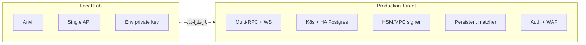

# آمادگی production

این سند صادقانه می‌گوید **چه چیز آماده نیست** و برای production واقعی چه لازم است.

## موضع پروژه

**eth-exchange-lab** = portfolio + learning با الگوهای production-minded.

> اجرای این repo روی mainnet با دارایی واقعی **توصیه نمی‌شود** بدون بازطراحی امنیتی، audit، و ops.

## چه چیز «production-minded» است

| حوزه | وضعیت |
|------|--------|
| Clean/Hexagonal architecture | ✅ |
| Double-entry ledger | ✅ |
| Idempotency keys | ✅ |
| Deposit confirmations | ✅ |
| Reorg detection (basic) | ✅ |
| Withdrawal approval workflow | ✅ (mock admin) |
| Outbox → Kafka | ✅ |
| Contract: OZ security primitives | ✅ |
| Graceful shutdown | ✅ |
| Health live/ready | ✅ |
| Safety flags (no mainnet default) | ✅ |

## چه چیز **آماده production نیست**

### ۱. Authentication & Authorization

- API باز — بدون JWT/session
- admin approve بدون role check

### ۲. Matching engine

- **In-memory** — restart = از دست orderbook
- بدون persistence و recovery
- throughput محدود single process

### ۳. Reorg بعد از credit

- `REORG_REVERSAL` در domain تعریف شده
- reversal خودکار deposit credited کامل نیست

### ۴. Rate limiting & abuse

- middleware ناقص
- بدون anti-bot

### ۵. Key management

- private key در env variable
- بدون HSM/MPC/multisig

### ۶. Observability

- metrics scaffold (`internal/platform/metrics`)
- tracing توزیع‌شده (OpenTelemetry) ناقص
- runbook/incident playbooks نداریم

### ۷. Compliance

- KYC/AML placeholder
- geo block، sanctions screening

### ۸. High availability

- single API instance
- Postgres single node در compose
- بدون failover RPC

### ۹. Testing gaps

- integration test محدود
- chaos test reorg نداریم
- load test matching نداریم

## دیاگرام: local vs production



## HSM / MPC / Multisig

| تکنولوژی | کاربرد |
|----------|--------|
| **HSM** | نگه‌داری کلید hot در hardware |
| **MPC** | امضا بدون کل کامل در یک node |
| **Multisig** | Vault owner چند امضا برای برداشت بزرگ |

این پروژه operator single key دارد — برای prod **کافی نیست**.

## Hot / Cold wallet

- **Hot:** محدود، automated withdraw کوچک
- **Cold:** اکثر دارایی — manual یا timelock

Reconciliation روزانه: `sum(EXCHANGE_HOT ledger)` ≈ Vault on-chain.

## Withdrawal policy production

- سقف روزانه per user
- delay ۲۴h برای آدرس جدید
- manual review بالای threshold
- 2FA admin approve

## Mainnet checklist (اگر ever)

- [ ] Audit contracts
- [ ] Pen test API
- [ ] HSM/MPC integration
- [ ] Persistent orderbook + HA
- [ ] Full authz
- [ ] Reorg reversal tested
- [ ] Monitoring + paging
- [ ] Legal/compliance review
- [ ] `ENABLE_MAINNET` فقط بعد sign-off
- [ ] Disaster recovery drill

## Config gates

```go
// internal/config/config.go
EnableSigning   // default false
EnableMainnet   // default false — needs APP_ENV=production
```

## اجرای local — intentional limits

```bash
ENABLE_SIGNING=false ./scripts/backend-run.sh
```

این **feature** است نه bug — جلوگیری از tx تصادفی.

## مسیر تکامل پیشنهادی

1. Auth + rate limit
2. Integration tests Postgres + Anvil
3. Persistent matcher (Redis/Postgres)
4. Reorg reversal کامل
5. Observability
6. Testnet deploy با MPC test
7. Audit → mainnet (optional)

## مستندات مرتبط

- [security-fa.md](./security-fa.md)
- [private-key-management-fa.md](./private-key-management-fa.md)
- [architecture-fa.md](./architecture-fa.md)
