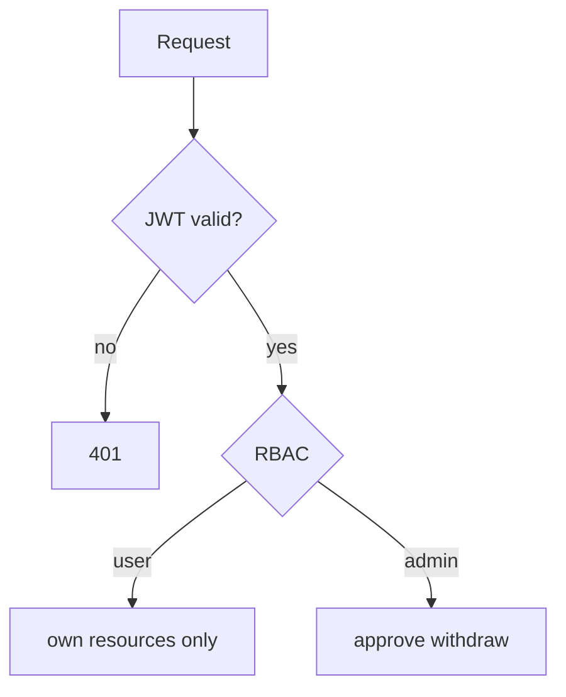

# امنیت

خلاصهٔ تهدیدها، کنترل‌های فعلی، و placeholderهایی که قبل production باید پر شوند.

## اصل کلی

این پروژه **شبیه‌سازی صرافی** است. هر عملیات balance-changing بحرانی است — مثل transfer در banking core.

## Secrets و کلیدها

### قوانین سخت

| ممنوع | دلیل |
|-------|------|
| commit `.env` | leak کلید |
| log `PRIVATE_KEY` | exposure در log aggregator |
| mainnet بدون approval | از دست رفتن دارایی واقعی |

### پیش‌فرض‌های امن config

```env
ENABLE_SIGNING=false
ENABLE_MAINNET=false
PRIVATE_KEY=
```

`config.Load()` enforce می‌کند:

- `ENABLE_MAINNET` فقط با `APP_ENV=production`
- mainnet نیاز `ENABLE_SIGNING=true`
- signing نیاز `PRIVATE_KEY`

### ذخیره secret در production

- Vault (HashiCorp)، AWS Secrets Manager، K8s secrets + encryption
- rotation دوره‌ای
- جدا کردن config deploy از image

جزئیات کلید: [private-key-management-fa.md](./private-key-management-fa.md)

## Authentication / Authorization (placeholder)

**وضعیت فعلی:** API بدون JWT/API key — هر client با UUID می‌تواند درخواست بزند.

### چرا placeholder کافی برای local؟

تمرکز روی ledger و chain integration است؛ auth layer بعداً اضافه می‌شود.

### production checklist



- OAuth2/OIDC یا API key per partner
- `user_id` از token — نه از body request
- admin routes جدا + MFA

## Idempotency

Header `Idempotency-Key` برای:

- `POST /api/v1/orders`
- `POST /api/v1/withdrawals`

جدول `idempotency_keys` — جلوگیری از duplicate side effect در retry.

**چرا؟** HTTP client ممکن است timeout بخورد و دوباره POST کند.

## Rate limiting

rule پروژه: rate limit برای endpointهای حساس.

**وضعیت فعلی:** middleware rate limit در `server.go` کامل پیاده نشده — فقط logging.

### production

- Redis sliding window per IP + per user
- stricter limit روی withdraw و auth
- WAF جلوی API gateway

## Financial controls

| control | وضعیت |
|---------|--------|
| Double-entry ledger | ✅ |
| Idempotent journals | ✅ |
| UoW transactions | ✅ |
| Row lock withdraw | partial — version column |
| Audit log | ✅ `audit_logs` |
| Manual withdraw approve | ✅ local admin route |

## Input validation

- UUID parse در handlers
- decimal amount validation
- destination address format (basic)

production: checksum address، blacklist، min/max withdraw.

## Logging

Structured logging با zerolog — **بدون** secret.

ممنوع log کردن:

- Private keys
- Raw Authorization header
- Full PAN/card (N/A here)

## Network

| local | production |
|-------|------------|
| HTTP plain | TLS 1.2+ |
| Postgres بدون SSL | sslmode=require |
| Anvil public port | RPC private VPC |

## Smart contract security

- ReentrancyGuard، Pausable، Ownable — Vault
- OpenZeppelin SafeERC20
- Foundry tests

قبل mainnet: **audit خارجی** اجباری.

## Dependency supply chain

- `go.mod` pin versions
- Foundry lock libs
- CI: `go vet`, `forge test`, vulnerability scan

## Dangerous actions (rule 06)

Agent/operator بدون approval صریح:

- mainnet tx
- drop database
- expose secrets

## اجرای محلی — safe mode

```bash
cp .env.example .env
# ENABLE_SIGNING=false بماند
./scripts/backend-run.sh
```

## مستندات مرتبط

- [production-readiness-fa.md](./production-readiness-fa.md)
- [private-key-management-fa.md](./private-key-management-fa.md)
- [cursor-rules-fa.md](./cursor-rules-fa.md) — rule 03, 06
