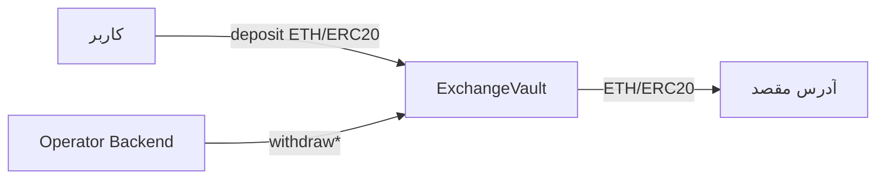
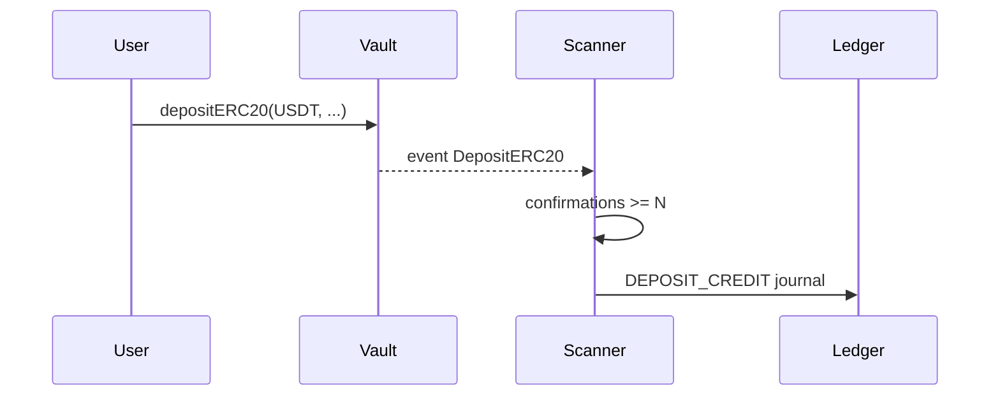
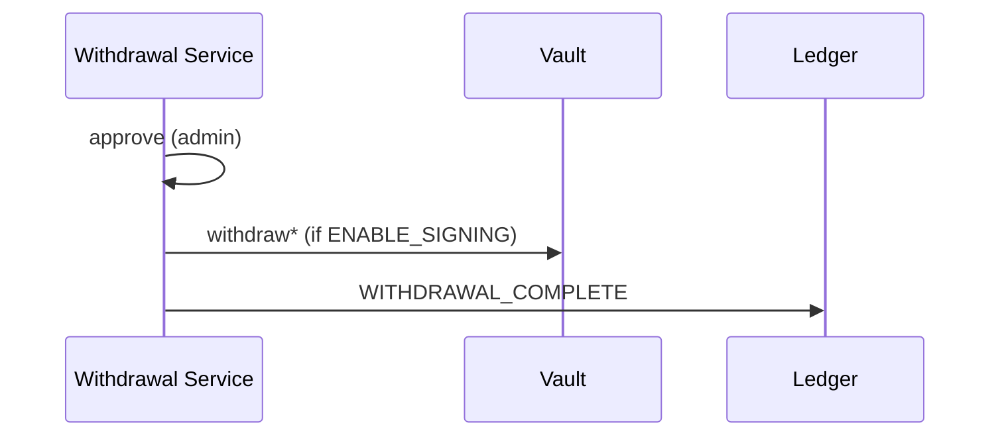

# قراردادهای هوشمند

این سند **MockUSDT** و **ExchangeVault** را توضیح می‌دهد — قراردادهای local این پروژه — به همراه نکات امنیتی.

## چرا دو قرارداد جدا؟

| قرارداد | نقش |
|---------|------|
| **MockUSDT** | توکن ERC20 تست با ۶ decimal (شبیه USDT) |
| **ExchangeVault** | custody on-chain — واریز کاربر و برداشت توسط operator |

صرافی واقعی often ترکیب hot wallet + قرارداد vault یا multisig است. اینجا Vault **نقطهٔ ورود/خروج on-chain** است؛ موجودی معاملاتی در PostgreSQL (ledger) است.

## MockUSDT

مسیر: `contracts/src/MockUSDT.sol`

### ویژگی‌ها

- OpenZeppelin `ERC20` + `Ownable`
- `decimals()` = **6** (مثل USDT واقعی)
- `mint(to, amount)` فقط **owner** — برای faucet محلی

### چرا ۶ decimal؟

USDT on-chain معمولاً ۶ رقم اعشار دارد. backend و scanner هنگام parse event، amount را `-6` shift می‌کنند (ETH برعکس ۱۸ decimal).

### امنیت

| موضوع | وضعیت local | production |
|-------|-------------|------------|
| mint آزاد | فقط owner | **هرگز** — USDT واقعی contract ثابت است |
| deploy | Anvil | آدرس canonical mainnet |

**این token فقط برای Anvil/local است.** روی mainnet deploy نکنید مگر explicitly برای lab جدا.

## ExchangeVault

مسیر: `contracts/src/ExchangeVault.sol`

### نقش



### OpenZeppelin primitives

- `Ownable` — owner می‌تواند operator را عوض کند و pause کند
- `Pausable` — توقف اضطراری واریز/برداشت
- `ReentrancyGuard` — روی transferهای خارجی
- `SafeERC20` — transfer امن ERC20

### توابع اصلی

| تابع | فراخواننده | توضیح |
|------|------------|--------|
| `receive()` / `depositETH(depositRef)` | کاربر | واریز ETH + event |
| `depositERC20(token, amount, depositRef)` | کاربر | نیاز به `approve` قبلی |
| `withdrawETH(to, amount, withdrawalId)` | operator/owner | برداشت ETH |
| `withdrawERC20(token, to, amount, withdrawalId)` | operator/owner | برداشت token |
| `setOperator` | owner | تغییر operator |
| `pause` / `unpause` | owner | emergency stop |

### Events (مهم برای scanner)

- `DepositETH(user, amount, depositRef)`
- `DepositERC20(token, user, amount, depositRef)`
- `WithdrawETH` / `WithdrawERC20`

backend با `chain_id + tx_hash + log_index` dedup می‌کند.

### Checks-Effects-Interactions

در `withdrawETH` ابتدا event emit، سپس `call{value}` — الگوی CEI برای کاهش reentrancy.

### `depositRef` / `withdrawalId`

`bytes32` برای correlate با رکورد off-chain (deposit/withdrawal UUID). در local می‌توان صفر گذاشت؛ production برای audit مفید است.

## Deploy محلی

```bash
./scripts/contracts-build.sh
./scripts/contracts-deploy-local.sh
```

اسکریپت Foundry: `contracts/script/DeployLocal.s.sol`

خروجی: `deployments/local.json` — آدرس‌ها را در `.env` بگذارید.

## تست Foundry

```bash
make contracts-test
# یا
./scripts/contracts-test.sh
```

تست‌ها در `contracts/test/` — شامل Vault deposit/withdraw و MockUSDT mint.

## ارتباط با backend



برداشت:



## نکات امنیتی (خلاصه)

1. **Operator key** = hot wallet — در production محدود، rotate، و ترجیحاً HSM/MPC
2. **Pause** — در incident فوراً فعال کنید
3. **ReentrancyGuard** — روی همهٔ external transfer
4. **Zero address** — revert با custom error
5. **فقط local signing** — `ENABLE_SIGNING=false` پیش‌فرض

## تفاوت با mainnet واقعی

| این پروژه | production واقعی |
|-----------|------------------|
| Vault ساده با یک operator | multisig، cold storage، policy |
| MockUSDT mint | USDT contract ثابت |
| Anvil reorg نادر | reorg و fee spike واقعی |
| بدون audit formal | audit توسط firm |

## مراجع کد

- `contracts/src/MockUSDT.sol`
- `contracts/src/ExchangeVault.sol`
- `internal/adapters/ethereum/tx_sender.go` — broadcast withdraw
- `internal/adapters/scanner/scanner.go` — parse deposit events
