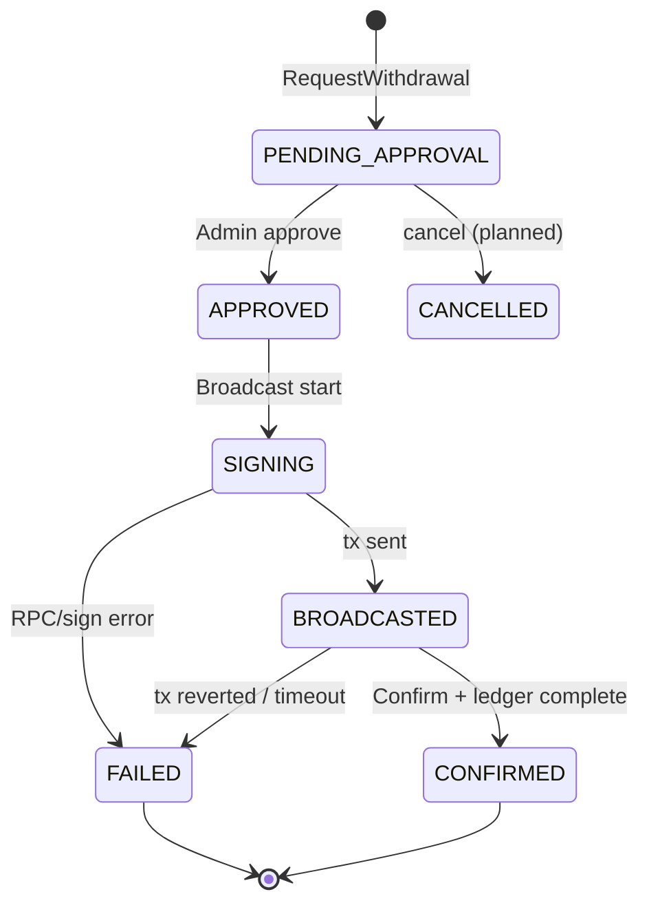
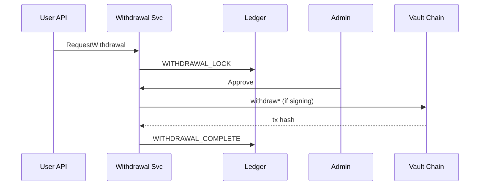

# جریان برداشت (Withdrawal)

برداشت پل بین **موجودی ledger off-chain** و **transfer on-chain از Vault** است. این سند state machine، ledger، و قوانین retry را توضیح می‌دهد.

## چرا workflow چندمرحله‌ای؟

در production:

- جلوگیری از سرقت با approve دستی / policy
- hot wallet limit
- AML/KYC checkpoint (placeholder در این پروژه)

حتی در local، فازها جدا هستند تا الگوی real exchange حفظ شود.

## State machine



تعریف statusها: `internal/domain/withdrawal/withdrawal.go`

| Status | معنی |
|--------|------|
| `PENDING_APPROVAL` | درخواست ثبت؛ موجودی withdrawal_locked |
| `APPROVED` | admin OK؛ آماده broadcast |
| `SIGNING` | در حال ساخت/امضای tx |
| `BROADCASTED` | tx_hash ثبت شد |
| `CONFIRMED` | on-chain OK؛ ledger نهایی |
| `FAILED` | خطا؛ `failure_reason` |
| `CANCELLED` | لغو قبل از broadcast |

## گام ۱ — درخواست

```http
POST /api/v1/withdrawals
Idempotency-Key: unique-key-1
Content-Type: application/json

{
  "user_id": "<uuid>",
  "asset": "USDT",
  "amount": "50",
  "destination": "0x742d35Cc6634C0532925a3b844Bc9e7595f0bEb0"
}
```

### ledger: `WITHDRAWAL_LOCK`

| Account | Direction |
|---------|-----------|
| USER_AVAILABLE | DEBIT |
| USER_WITHDRAWAL_LOCKED | CREDIT |

### side effects

- insert `withdrawals`
- outbox: `exchange.withdrawal.requested`
- audit: `withdrawal.requested`

## گام ۲ — تأیید admin (local mock)

```http
POST /api/v1/admin/withdrawals/{id}/approve
```

**چرا endpoint جدا؟** در production auth role `ADMIN` + MFA + limit.

بدون auth واقعی — **فقط local**.

## گام ۳ — Broadcast on-chain

فقط اگر `ENABLE_SIGNING=true` و `PRIVATE_KEY` operator تنظیم شده.

Service: `withdrawalsvc.Broadcast`

1. status → `SIGNING`
2. `txSender.SendVaultWithdrawETH` یا `SendVaultWithdrawERC20`
3. موفق → `BROADCASTED` + `tx_hash`
4. خطا → `FAILED` + reason

`withdrawalId` به `bytes32` برای correlate با event Vault.

### پیش‌فرض امن

```env
ENABLE_SIGNING=false
```

`Broadcast` خطا می‌دهد: `signing disabled` — **عمدی**.

## گام ۴ — Confirm

`Confirm(withdrawalID)`:

- فقط از `BROADCASTED`
- journal `WITHDRAWAL_COMPLETE`: withdrawal_locked → EXCHANGE_HOT
- status → `CONFIRMED`

**نکته:** در نسخه فعلی confirm ممکن است manual/admin باشد؛ production worker tx receipt را poll می‌کند.

## دیاگرام sequence



## Retry rules

| مرحله | retry امن؟ | کلید |
|-------|------------|------|
| Request | بله | `Idempotency-Key` header |
| Approve | idempotent اگر already approved | withdrawal id |
| Broadcast | **خطرناک** بدون idempotency on-chain | همان withdrawal_id → bytes32 |
| Confirm | بله | `withdrawal-complete:<uuid>` |

### Broadcast failure

- status → `FAILED`
- موجودی در `USER_WITHDRAWAL_LOCKED` می‌ماند
- production: workflow unlock یا manual investigation

**هرگز** blind retry broadcast بدون چک tx قبلی — risk double payout on-chain.

### Idempotency ledger

- lock: `withdrawal-lock:<client-key>`
- complete: `withdrawal-complete:<withdrawal_uuid>`

## Nonce management

فیلد `nonce` در جدول withdrawals برای tracking — tx sender باید nonce operator را serialize کند (production: queue per hot wallet).

## API

```http
GET /api/v1/withdrawals/{id}
```

## اجرای محلی با signing (اختیاری — با احتیاط)

```env
ENABLE_SIGNING=true
PRIVATE_KEY=0xac0974bec39a17e36ba4a6b4d238ff944bacb478cbed5efcae784d7bf4f2ff80
```

این کلید **اولین account پیش‌فرض Anvil** است — **فقط local**.

1. Approve withdrawal
2. فراخوانی broadcast (endpoint admin/service internal)
3. Confirm بعد از mine شدن tx

## ریسک production

| ریسک | control |
|------|---------|
| Hot key compromise | HSM, MPC, limits |
| Double withdraw | idempotency + DB lock + nonce |
| Wrong destination | whitelist, 24h delay |
| Insufficient Vault balance | pre-check on-chain |
| Admin endpoint exposed | authn/z + network policy |

## مستندات مرتبط

- [private-key-management-fa.md](./private-key-management-fa.md)
- [smart-contracts-fa.md](./smart-contracts-fa.md)
- [security-fa.md](./security-fa.md)
- [production-readiness-fa.md](./production-readiness-fa.md)
